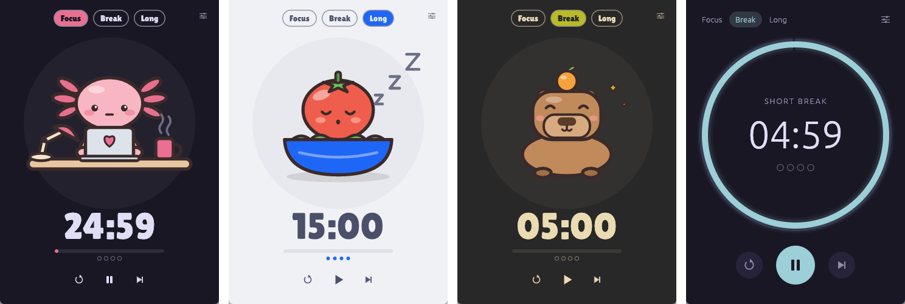

# 🍅 dpomo

A **beautiful**, **lightweight** and **customizable** Pomodoro timer, with a little friend who works
and rests with you. 🦎💗 Built with Rust and [egui](https://github.com/emilk/egui).

**English** · [Português](README.pt-BR.md)



## What's Pomodoro?

Focus for **25 minutes**, rest for **5**. Every **4 sessions**, take a long **15-minute** break. That's it.
(You can change all of these numbers.)

## Download

| System | Download | How to install |
| ------ | -------- | -------------- |
| **Windows** | [dpomo-setup.exe](https://github.com/diegorezm/dpomo/releases/latest/download/dpomo-setup.exe) | Open it and click *Next* until the end. No admin password needed. |
| **Linux** (Ubuntu/Debian) · *beta* | [dpomo-linux-amd64.deb](https://github.com/diegorezm/dpomo/releases/latest/download/dpomo-linux-amd64.deb) | Double-click it, or `sudo apt install ./dpomo-linux-amd64.deb` |
| **macOS** · *beta* | [dpomo-macos.dmg](https://github.com/diegorezm/dpomo/releases/latest/download/dpomo-macos.dmg) | Drag dpomo into *Applications*. |

More options (a portable Windows version, a `.tar.gz` for other Linux distros) are on the
[releases page](https://github.com/diegorezm/dpomo/releases/latest).

> **Windows:** if you see "Windows protected your PC", click *More info* → *Run anyway*.
> That happens because the installer isn't digitally signed yet.
>
> **macOS:** the first time, **right-click** dpomo → *Open* → *Open*. The app isn't notarized by Apple,
> so macOS asks once.
>
> **Linux:** to see the tray icon on GNOME, install the *AppIndicator* extension (KDE works out of the box).

To uninstall on Windows: *Settings → Apps → dpomo → Uninstall*.

## How to use

1. Open the app.
2. Press the play button (or **Space**).
3. When time's up, you get a **sound** and a **notification**. 🔔

Your companion changes with you: it waves while idle, works while you focus, relaxes on short breaks and
naps on long ones.

### It runs in the background

dpomo lives in the **system tray** (the small icons next to the clock):

- Closing the window **doesn't quit**: the timer keeps going in the tray.
- The tray icon shows a live **progress ring**; hover it to see the time left.
- **Click** the icon to show/hide the window; **right-click** for the menu (start/pause, skip, restart, **quit**).
- Opened dpomo twice by accident? No problem, it just shows the window that's already running.
- Closed the app or restarted your computer mid-session? It **picks up where you left off** (paused).
- Want it to start with your computer? Turn on **Start when I log in** in the settings.

### Shortcuts

| Key | What it does |
| --- | ------------ |
| `Space` | Start / pause |
| `R` | Restart the phase |
| `S` | Skip to the next phase |
| `1` `2` `3` | Go to focus / short break / long break |
| `,` | Open settings |
| `Esc` | Leave settings |

Every shortcut can be changed in `config.toml` (the `[keys]` section, see [Configuration](#configuration)).

## Make it yours

Click the settings icon (top-right corner). You can change:

- 🦎 **Style**: *Cozy* (with a character) or *Classic* (a minimal progress ring)
- 🐾 **Character**: axolotl, tomato or capybara — or [your own](#make-your-own-character-)
- 🎨 **Theme**: 8 built-in (Rosé Pine, Catppuccin, Tokyo Night, Nord, Gruvbox, Mono, Latte, Paper) or [your own](#make-your-own-theme-)
- ⏱️ **Durations** of focus and breaks, and how many sessions until the long break
- 🔔 **Sound**: chime, bell, soft, or any `.wav`/`.mp3`/`.ogg` file, with volume
- 📊 **Statistics**: sessions and focus time today, this week and all time
- 🌍 **Language**: English or Portuguese (follows your system by default)
- 🔍 Interface **size**, always on top, auto-start phases, tray behavior and more

## Configuration

**All** settings live in a plain text file, `config.toml`. The settings screen just edits that file for you.
It's created the first time dpomo opens:

| System | Location |
| ------ | -------- |
| Windows | `%APPDATA%\dpomo\config.toml` |
| Linux | `~/.config/dpomo/config.toml` |
| macOS | `~/Library/Application Support/dpomo/config.toml` |

(The settings screen has **Open config.toml** and **Open folder** buttons.)

- **Edit and save: the app applies it right away**, no restart needed.
- Delete anything you don't care about: missing keys use their default.
- Made a typo? The app tells you which line is wrong and **never overwrites your file** until you fix it.

Everything you can configure, with the defaults:

```toml
[timer]
focus_minutes = 25
short_break_minutes = 5
long_break_minutes = 15
sessions_before_long_break = 4
auto_start_breaks = false        # start breaks by themselves
auto_start_focus = false         # start focus by itself

[appearance]
language = "auto"                # "auto" (follow the system), "en" or "pt-BR"
layout = "cozy"                  # "cozy" (character) or "classic" (ring)
character = "axolotl"            # character folder: "axolotl", "tomato", "capybara"…
theme = "Rosé Pine"              # a theme name, or "custom" (uses [custom_theme])
ring_thickness = 10.0            # "classic" only
ui_scale = 1.0                   # interface size
smooth_animation = true          # false = uses even less CPU
glow = true                      # ring glow ("classic")
show_session_dots = true

[behavior]
always_on_top = false
notify_on_finish = true          # flash the taskbar
focus_on_finish = false          # bring the window to the front
time_in_title = true             # time left in the window title
tray = true                      # tray icon
close_to_tray = true             # closing = hiding in the tray
system_notification = true
start_with_system = false
start_hidden = false             # start hidden in the tray
check_updates = true             # see "Privacy" below

[sound]
enabled = true
kind = "chime"                   # "chime", "bell", "soft" or "file"
file = ""                        # path to a .wav/.mp3/.ogg when kind = "file"
volume = 0.6                     # 0.0 to 1.0

[window]
width = 360.0
height = 500.0
remember_size = true             # keep the last size when closing

[keys]                           # key names: "Space", "R", ",", "1", "F5", "Escape", "ArrowLeft"…
toggle = "Space"
reset = "R"
skip = "S"
settings = ","
focus = "1"
short_break = "2"
long_break = "3"
back = "Escape"

[custom_theme]                   # used when theme = "custom"
background = "#191724"
surface = "#26233a"
text = "#e0def4"
muted = "#908caa"
focus = "#eb6f92"
short_break = "#9ccfd8"
long_break = "#c4a7e7"
```

Your progress and statistics are kept separately in `state.toml` (same folder), written by the app.

### Make your own theme 🎨

Themes are `.toml` files. Put yours in a `themes` folder next to `config.toml`
(e.g. `%APPDATA%\dpomo\themes\dracula.toml`):

```toml
name = "Dracula"
background = "#282a36"
surface = "#44475a"      # cards, buttons and the ring track
text = "#f8f8f2"
muted = "#a4a8c4"        # secondary text
focus = "#ff79c6"        # focus color
short_break = "#50fa7b"  # short break color
long_break = "#bd93f9"   # long break color
```

Then click **Reload themes and characters** in the settings. Done!

Rather pick colors by clicking? Choose **Custom**, tweak the colors and click **Save as file**.
Want to share it? Just send the file to someone. 😉

### Make your own character 🦎

Create a folder in `characters`, next to `config.toml` (e.g. `%APPDATA%\dpomo\characters\cat\`), with these SVGs:

| File | When it shows |
| ---- | ------------- |
| `idle.svg` | idle (**required**) |
| `focus.svg` | focusing |
| `short_break.svg` | short break |
| `long_break.svg` | long break |

Missing one? `idle.svg` is used instead. To name it, add a `character.toml`:

```toml
name = "Cat"

[names]
"pt-BR" = "Gato"
```

Tip: in your SVG, the color `#e05a4f` becomes the phase color (red for focus, green for breaks…) and
`#7a6464` becomes the theme's secondary text color, so your character matches every theme.

## Performance

Measured on Windows 11 (release build, 16-core CPU):

| Situation | CPU | Note |
| --------- | --- | ---- |
| Paused | **0%** | nothing runs until you click |
| Running, window open | ~0.2% of the machine | smooth 30 fps animation (turn it off for less) |
| Running, hidden in the tray | ~0.05% | wakes up once per second |

The app is a ~10 MB executable. Memory shows as ~110 MB, but most of that is the GPU driver's OpenGL
runtime loaded into the process (on our test machine the driver alone was ~80 MB).

## Privacy

dpomo has no accounts, no telemetry and no ads. The only network request is the update check: once a
day it asks GitHub's public API for the latest release version. It never downloads or installs anything
by itself. Turn it off with `check_updates = false` (or in the settings).

## Build it yourself

You need [Rust](https://rustup.rs):

```sh
cargo install --git https://github.com/diegorezm/dpomo
```

> **Linux:** first install `libxkbcommon-dev`, `libgl1-mesa-dev`, `libwayland-dev` and `libasound2-dev`.

Contributing? Start with [AGENTS.md](AGENTS.md) — it explains how the project works (it's written for
AI agents, but humans like it too).

## License

[MIT](LICENSE). Do whatever you want. 🙂
