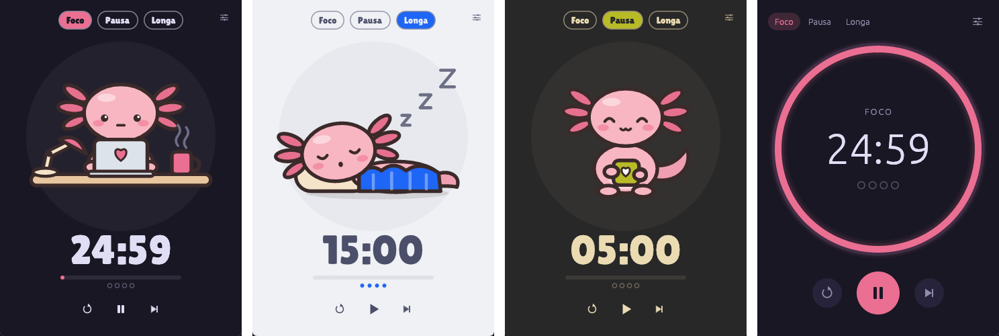

# 🍅 Pomolotl

Um timer Pomodoro **bonito**, **leve** e **do seu jeito**, com um amiguinho que trabalha e descansa
junto com você. 🦎💗 Feito em Rust com [egui](https://github.com/emilk/egui).

[English](README.md) · **Português** · 🌐 [Site](https://diegorezm.github.io/pomolotl/)



## O que é Pomodoro?

Você trabalha focado por **25 minutos** e descansa **5**. A cada **4 sessões**, faz uma pausa longa de **15**.
Só isso. (Todos esses números você pode mudar.)

## Baixar

| Sistema | Download | Como instalar |
| ------- | -------- | ------------- |
| **Windows** | [pomolotl-setup.exe](https://github.com/diegorezm/pomolotl/releases/latest/download/pomolotl-setup.exe) | Abra e clique em *Avançar* até o fim. Não pede senha de administrador. |
| **Linux** (Ubuntu/Debian) · *beta* | [pomolotl-linux-amd64.deb](https://github.com/diegorezm/pomolotl/releases/latest/download/pomolotl-linux-amd64.deb) | Dois cliques no arquivo, ou `sudo apt install ./pomolotl-linux-amd64.deb` |
| **macOS** · *beta* | [pomolotl-macos.dmg](https://github.com/diegorezm/pomolotl/releases/latest/download/pomolotl-macos.dmg) | Arraste o Pomolotl para *Aplicativos*. |

Outras opções (versão portátil para Windows, `.tar.gz` para outros Linux, Linux ARM64) estão na
[página de releases](https://github.com/diegorezm/pomolotl/releases/latest).

> **Windows:** se aparecer "O Windows protegeu o computador", clique em *Mais informações* → *Executar assim mesmo*.
> Isso acontece porque o instalador ainda não é assinado digitalmente.
>
> **macOS:** na primeira vez, clique com o **botão direito** no Pomolotl → *Abrir* → *Abrir*.
> O app não é notarizado pela Apple, então o macOS pede essa confirmação uma vez.
>
> **Linux:** para ver o ícone na bandeja no GNOME, instale a extensão *AppIndicator* (KDE já funciona direto).

Para desinstalar no Windows: *Configurações → Aplicativos → Pomolotl → Desinstalar*.

## Como usar

1. Abra o app.
2. Aperte o botão de play (ou **Espaço**).
3. Quando o tempo acabar, você ouve um **som** e recebe uma **notificação**. 🔔

Seu companheiro muda junto com você: acena quando está parado, trabalha durante o foco, relaxa na pausa
curta e tira uma soneca na pausa longa.

### Fica rodando em segundo plano

O Pomolotl mora na **bandeja do sistema** (os ícones pequenos perto do relógio):

- Fechar a janela **não fecha o app**: ele continua contando lá na bandeja.
- O ícone mostra o **anel de progresso** ao vivo; passe o mouse para ver o tempo.
- **Clique** no ícone para mostrar/esconder a janela; **botão direito** abre o menu (iniciar/pausar, pular, reiniciar, **sair**).
- Abriu o Pomolotl de novo sem querer? Tudo bem, ele só mostra a janela que já estava aberta.
- Fechou o app ou reiniciou o computador no meio da sessão? Ele **continua de onde parou** (pausado).
- Quer que ele abra sozinho quando ligar o computador? Ative **Iniciar com o sistema** nos ajustes.

### Timer flutuante

Quer o tempo sempre à vista? Ligue o **timer flutuante** (o botãozinho quadrado no topo da janela, a
tecla `M` ou o menu da bandeja): uma janelinha que fica por cima de tudo com o tempo que falta, a fase e
o seu companheiro. Arraste para onde quiser, puxe o canto para aumentar ou diminuir, clique duas vezes
para abrir o Pomolotl. Ela continua funcionando com a janela principal escondida na bandeja.

### Atalhos

| Tecla | O que faz |
| ----- | --------- |
| `Espaço` | Iniciar / pausar |
| `R` | Reiniciar a fase |
| `S` | Pular para a próxima fase |
| `1` `2` `3` | Ir para foco / pausa curta / pausa longa |
| `M` | Mostrar / esconder o timer flutuante |
| `,` | Abrir ajustes |
| `Esc` | Fechar os ajustes |

Dá para trocar qualquer atalho no `config.toml` (seção `[keys]`, veja [Configuração](#configuração)).

### Linha de comando

Rodar `pomolotl` de novo com uma destas opções conversa com o Pomolotl que já está aberto (ou abre ele):

| Comando | O que faz |
| ------- | --------- |
| `pomolotl --toggle` | Iniciar / pausar |
| `pomolotl --skip` | Pular para a próxima fase |
| `pomolotl --reset` | Reiniciar a fase |
| `pomolotl --show` | Mostrar a janela |
| `pomolotl --mini` | Mostrar / esconder o timer flutuante |
| `pomolotl --settings` | Abrir os ajustes |
| `pomolotl --quit` | Sair |

Útil para um **atalho global**: associe `pomolotl --toggle` a uma tecla nas configurações de teclado do
sistema (no Windows: um atalho para `pomolotl.exe --toggle` com uma *Tecla de atalho* nas propriedades).

## Personalizar

Clique no ícone de ajustes (canto superior direito). Você pode mudar:

- 🦎 **Estilo**: *Aconchegante* (com um personagem) ou *Clássico* (um anel de progresso minimalista)
- 🐾 **Personagem**: axolote, tomate ou capivara — ou [o seu](#criar-seu-próprio-personagem-)
- 🎨 **Tema**: 8 prontos (Rosé Pine, Catppuccin, Tokyo Night, Nord, Gruvbox, Mono, Latte, Paper) ou [o seu](#criar-seu-próprio-tema-)
- ⏱️ **Tempos** de foco e pausas, e quantas sessões até a pausa longa
- 🔔 **Som**: sininho, sino, suave ou qualquer arquivo `.wav`/`.mp3`/`.ogg`, com volume
- 📊 **Estatísticas**: sessões e tempo de foco hoje, na semana e no total
- 🌍 **Idioma**: inglês ou português (segue o sistema por padrão)
- 🔍 **Tamanho** da interface, sempre no topo, iniciar fases sozinho, bandeja e mais

## Configuração

**Toda** a configuração fica num arquivo de texto, o `config.toml`. Os ajustes do app só editam esse
arquivo por você. Ele é criado na primeira vez que o Pomolotl abre:

| Sistema | Onde fica |
| ------- | --------- |
| Windows | `%APPDATA%\pomolotl\config.toml` |
| Linux | `~/.config/pomolotl/config.toml` |
| macOS | `~/Library/Application Support/pomolotl/config.toml` |

(Nos ajustes há os botões **Abrir config.toml** e **Abrir pasta**.)

- **Mudou e salvou? O app aplica na hora**, não precisa reiniciar.
- Pode apagar o que não quiser: o que faltar usa o padrão.
- Errou algo? O app avisa qual linha está errada e **não mexe no seu arquivo** até você corrigir.

Tudo o que dá para configurar, com os valores padrão (o [guia de configuração](https://diegorezm.github.io/pomolotl/docs.html)
explica cada opção, os nomes de teclas e como criar temas e personagens):

```toml
[timer]
focus_minutes = 25
short_break_minutes = 5
long_break_minutes = 15
sessions_before_long_break = 4
auto_start_breaks = false        # começar a pausa sozinho
auto_start_focus = false         # começar o foco sozinho

[appearance]
language = "auto"                # "auto" (segue o sistema), "en" ou "pt-BR"
layout = "cozy"                  # "cozy" (personagem) ou "classic" (anel)
character = "axolotl"            # pasta do personagem: "axolotl", "tomato", "capybara"…
theme = "Rosé Pine"              # nome de um tema, ou "custom" (usa [custom_theme])
ring_thickness = 10.0            # só no "classic"
ui_scale = 1.0                   # tamanho da interface
smooth_animation = true          # false = gasta ainda menos CPU
glow = true                      # brilho no anel ("classic")
show_session_dots = true

[behavior]
always_on_top = false
notify_on_finish = true          # piscar na barra de tarefas
focus_on_finish = false          # trazer a janela pra frente
time_in_title = true             # tempo no título da janela
tray = true                      # ícone na bandeja
close_to_tray = true             # fechar = esconder na bandeja
system_notification = true
start_with_system = false
start_hidden = false             # abrir já escondido na bandeja
check_updates = true             # veja "Privacidade" abaixo

[sound]
enabled = true
kind = "chime"                   # quando a pausa começa: "chime" (sininho), "bell" (sino), "soft" (suave) ou "file"
file = ""                        # caminho de um .wav/.mp3/.ogg quando kind = "file"
# focus_kind = "bell"            # quando o foco começa (sem isso = igual a kind)
# focus_file = ""                # o arquivo dele, quando focus_kind = "file" (vazio = file)
volume = 0.6                     # de 0.0 a 1.0
ticking = false                  # tique suave a cada segundo durante o foco
ticking_volume = 0.3

[window]
width = 360.0
height = 500.0
remember_size = true             # guarda o último tamanho ao fechar

[mini]                           # timer flutuante: pequeno, sempre por cima
enabled = false
width = 260.0                    # arraste para mover, puxe o canto para redimensionar
height = 96.0
show_character = true
# x = 1600.0 / y = 40.0 aparecem quando você move ele

[keys]                           # nomes de tecla: "Space", "R", ",", "1", "F5", "Escape", "ArrowLeft"…
toggle = "Space"
reset = "R"
skip = "S"
settings = ","
focus = "1"
short_break = "2"
long_break = "3"
mini = "M"
back = "Escape"

[custom_theme]                   # usado quando theme = "custom"
background = "#191724"
surface = "#26233a"
text = "#e0def4"
muted = "#908caa"
focus = "#eb6f92"
short_break = "#9ccfd8"
long_break = "#c4a7e7"
```

Seu progresso e suas estatísticas ficam separados, no `state.toml` (mesma pasta), escrito pelo app.

### Criar seu próprio tema 🎨

Temas são arquivos `.toml`. Coloque o seu na pasta `themes`, ao lado do `config.toml`
(ex.: `%APPDATA%\pomolotl\themes\dracula.toml`):

```toml
name = "Dracula"
background = "#282a36"   # fundo
surface = "#44475a"      # cartões, botões e trilho do anel
text = "#f8f8f2"         # texto
muted = "#a4a8c4"        # texto secundário
focus = "#ff79c6"        # cor do foco
short_break = "#50fa7b"  # cor da pausa curta
long_break = "#bd93f9"   # cor da pausa longa
```

Depois, nos ajustes, clique em **Recarregar temas e personagens**. Pronto!

Prefere escolher as cores clicando? Selecione **Personalizado**, ajuste as cores e clique em
**Salvar como arquivo**. Quer compartilhar? É só mandar o arquivo para alguém. 😉

### Criar seu próprio personagem 🦎

Crie uma pasta em `characters`, ao lado do `config.toml` (ex.: `%APPDATA%\pomolotl\characters\gato\`),
com estes arquivos SVG:

| Arquivo | Quando aparece |
| ------- | -------------- |
| `idle.svg` | parado (**obrigatório**) |
| `focus.svg` | focando |
| `short_break.svg` | pausa curta |
| `long_break.svg` | pausa longa |

Faltou algum? Ele usa o `idle.svg` no lugar. Para dar um nome, crie um `character.toml`:

```toml
name = "Cat"

[names]
"pt-BR" = "Gato"
```

Dica: no SVG, a cor `#e05a4f` vira a cor da fase (vermelho no foco, verde na pausa…) e `#7a6464`
vira a cor de texto secundário do tema. Assim seu personagem combina com qualquer tema.

## Desempenho

Medido no Windows 11 (versão release, CPU de 16 núcleos):

| Situação | CPU | Observação |
| -------- | --- | ---------- |
| Pausado | **0%** | nada roda até você clicar |
| Rodando, janela aberta | ~0,2% da máquina | animação suave a 30 fps (dá para desligar) |
| Rodando, escondido na bandeja | ~0,05% | acorda uma vez por segundo |

Memória (coluna "Memória" do Gerenciador de Tarefas): **~12 MB** aberto e pausado, **~45 MB** com a
animação suave rodando, **~7 MB** escondido na bandeja. O executável para Windows tem ~13 MB.

Sem OpenGL na máquina (máquina virtual, área de trabalho remota, Windows ARM)? O Pomolotl passa a usar
o Direct3D 12 sozinho; gasta mais memória assim, mas funciona.

## Privacidade

O Pomolotl não tem conta, telemetria nem anúncios. Seus ajustes, estatísticas e sessão ficam no seu
computador, na pasta de configuração.

A única conexão de rede é a **verificação de atualização**: uma vez por dia o Pomolotl pergunta à API
pública do GitHub (`api.github.com`) qual é o número da versão mais nova. Nada sobre você é enviado, só
uma requisição web comum (o GitHub vê seu endereço IP, veja a [declaração de privacidade do GitHub](https://docs.github.com/site-policy/privacy-policies/github-general-privacy-statement)).
Ele nunca baixa nem instala nada sozinho. Para desligar: nos ajustes, com `check_updates = false` ou
desmarcando *Procurar novas versões* no instalador do Windows.

## Compilar você mesmo

Precisa do [Rust](https://rustup.rs):

```sh
cargo install --git https://github.com/diegorezm/pomolotl
```

> **Linux:** instale antes `libxkbcommon-dev`, `libgl1-mesa-dev`, `libwayland-dev` e `libasound2-dev`.

Quer contribuir? Comece pelo [AGENTS.md](AGENTS.md), que explica como o projeto funciona.

## Licença

[MIT](LICENSE). Faça o que quiser. 🙂
